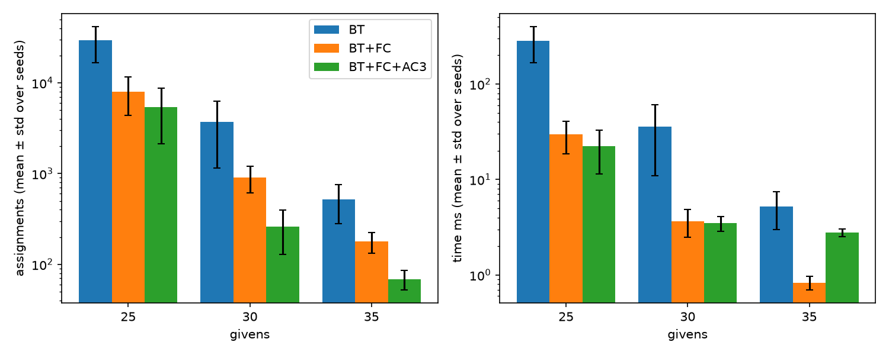
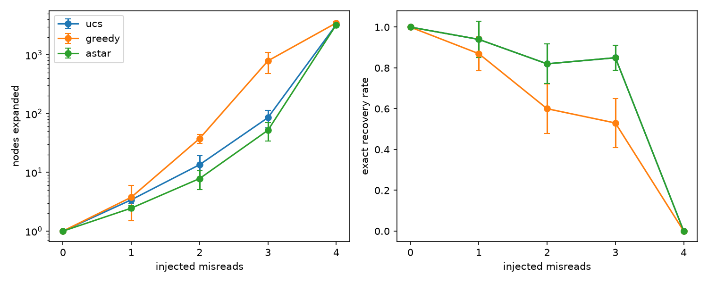
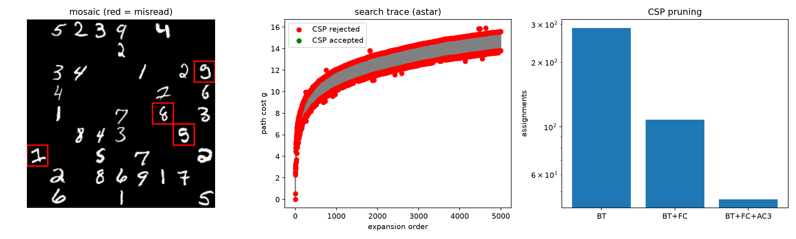
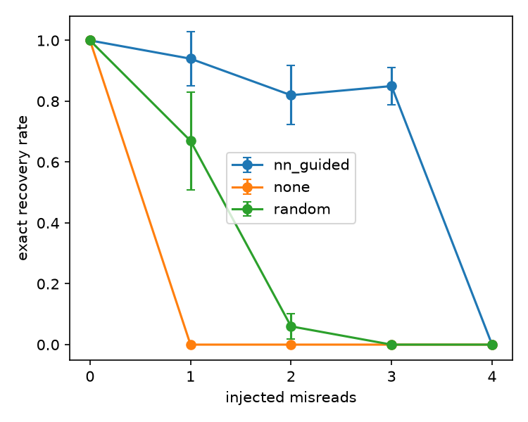

# Handwritten Sudoku Reader and Solver: Search + CSP + Neural Network

Name: ______  Course: Intelligent Systems, E-JUST  Project: P7

## 1. Problem and users

A Sudoku is written by hand and scanned as a 9x9 mosaic of digit images. A neural network reads each digit, but a misread (for example a 7 read as a 1) can make the puzzle contradictory or unsolvable. This project builds a decision-support pipeline that finds the most likely misread digits, corrects them, and solves the puzzle. If it cannot, it reports "unreadable" and lists the least confident cells. Intended users are puzzle apps and education tools. This is a course project, not a deployed system.

The system combines three techniques:
- Neural network: a CNN reads each digit and outputs probabilities for digits 1-9. The probabilities become the costs of corrections.
- Search: UCS, Greedy and A* look for the cheapest set of at most 3 corrections.
- CSP: Backtracking (BT), Forward Checking (FC) and AC-3, as switchable parts with counters, check whether a corrected puzzle is solvable and solve it.

Flow: mosaic -> blank-cell rule -> CNN reading -> search over correction sets, each candidate validated by the CSP -> solution plus correction log (or "unreadable").

## 2. Data

Real data: MNIST images and labels, with digit 0 dropped (labels 1-9). The training images are split with a seeded shuffle into 45,064 train and 9,013 validation images. The test set (9,020 images) is untouched. Raw files are downloaded once by `make_data.py` and their SHA-256 checksums are recorded.

Generated data:
- Sudoku puzzles: a full grid is built by seeded randomised backtracking. Cells are then blanked in random order, and a blank is kept only if the solution stays unique (solutions are counted, stopping at 2). Puzzles have 25, 30 or 35 givens. Each puzzle is derived from its seed, so it is reproducible.
- Mosaics: 9x9 tiles of 28x28 test images (252x252 pixels). Blank cells are all-zero tiles and are detected by a rule (max pixel below 0.1), not by the NN.
- Misread injection: a 98% CNN rarely errs on its own, so errors are injected by a documented rule. For m injected cells, a test image of the right digit is used that the CNN misreads but whose true digit is its second choice (the "hard pool"). All other given cells use correctly read images, so the number of misreads is exactly m. In the check run, the misread cells matched the injected cells for m = 0 to 4.

Limits of the data: the hard pool is small (3 to 39 images per digit; digit 5 has 3, digit 9 has 39) compared with about 900-1,100 correctly read images per digit. The digits are centred MNIST digits, not photographed Sudoku. `DATA_DICTIONARY.md` lists every item as real or generated.

## 3. Neural network

Models: a logistic regression baseline (one linear layer plus softmax on 784 pixels) and a small CNN (two conv layers with max-pooling, two dense layers, 9 outputs). The CNN was trained for 5 epochs with Adam and light augmentation (random shifts of up to 2 pixels), with a fixed seed.

Results on the untouched test set (9,020 images):

| Model | Accuracy | ECE | NLL |
|---|---|---|---|
| Logistic regression | 0.9224 | 0.0029 | 0.2820 |
| CNN | 0.9838 | 0.0063 | 0.0482 |

On the validation set the CNN reached 0.9828 (rising every epoch from 0.9493) and logistic regression 0.9148.

The CNN beats the baseline by about 6 points of accuracy and is much better on NLL. ECE is slightly lower for logistic regression; both values are tiny, so both models are well calibrated, and I do not claim the CNN is better calibrated. Temperature scaling was skipped because ECE was already small. Calibration matters because the search costs use `-log(p_new) + log(p_old)`.

Confusion matrix (`models/confusion_cnn.csv`): most counts are on the diagonal. The largest single error is true 3 predicted as 5 (17 cases).

## 4. CSP

Model: 81 variables, domains 1-9, binary "different from each peer" constraints (20 peers per cell). Givens are fixed.

Switchable parts, each with counters:
- Backtracking: assign cells in order, undo on failure. Counters: assignments and backtracks.
- Forward Checking: after placing a digit, remove it from unassigned peers' domains; fail at once if a domain empties.
- AC-3: arc consistency run once before search. It removes values with no support and detects conflicts (two equal givens in a row empty a domain). Counters: revisions and removals.
- MRV and degree heuristics: optional extras for choosing the next cell.

Experiment 2 (50 puzzles per givens level, 5 seeds, mean ± std over seed means):

| Givens | Config | Assignments | Time (ms) | Capped runs |
|---|---|---|---|---|
| 25 | BT | 29275.6 ± 12532.2 | 283.7 | 3/50 |
| 25 | BT+FC | 7979.0 ± 3581.1 | 29.6 | 0/50 |
| 25 | BT+FC+AC3 | 5435.8 ± 3293.7 | 22.2 | 0/50 |
| 30 | BT | 3731.3 ± 2582.7 | 35.9 | 0/50 |
| 30 | BT+FC | 903.9 ± 295.3 | 3.7 | 0/50 |
| 30 | BT+FC+AC3 | 261.9 ± 133.0 | 3.5 | 0/50 |
| 35 | BT | 516.2 ± 236.2 | 5.2 | 0/50 |
| 35 | BT+FC | 178.8 ± 46.2 | 0.8 | 0/50 |
| 35 | BT+FC+AC3 | 68.9 ± 16.7 | 2.8 | 0/50 |

Assignments fall at every level: BT > FC > FC+AC3 (at 35 givens: 516, 179, 69). Time tells a different story on easy puzzles: at 35 givens FC+AC3 is slower than FC (2.8 vs 0.8 ms) because the one-off AC-3 pass costs about 8,400 revisions; at 30 givens it is a tie (3.5 vs 3.7 ms); at 25 givens AC-3 is faster (22.2 vs 29.6 ms). Counts alone can therefore mislead, so both measures are reported. Three of the 50 plain-BT runs at 25 givens hit the 200,000-assignment cap, so BT's 25-given numbers are lower bounds. Counter check: assignments minus backtracks equals the number of empty cells (46 at 35 givens).

## 5. Search

State: a frozenset of (cell, new_digit) corrections; the start is the empty set (the first reading). Action: change one more cell to one of its top-3 alternative digits; at most 3 corrections. Step cost: `-log(p_new) + log(p_old)`, never negative because the read digit is the top-1. Goal test: the corrected grid has no conflicts and the CSP solves it. Counters: nodes expanded, nodes generated, and goal calls (CSP checks). Repeated states are skipped with an explored set.

- UCS expands by path cost g; it finds the cheapest correction set.
- Greedy expands by heuristic h only; it is not optimal.
- A* expands by g + h.

Heuristic: h = 0 if the corrected grid has no conflicts; otherwise h is the cheapest single remaining correction. Any solution needs at least one more change costing at least that much, so h never overestimates. Counting conflict pairs would not be admissible, because one changed cell can resolve several conflicts at once. Greedy uses the same h.

Search was tested on a small example with a known answer (cheapest fix and its cost log(0.6/0.3)), and A* and UCS returned the same cost.

### Experiment 1: UCS vs Greedy vs A* (35-given puzzles, 100 puzzles per misread level, 5 seeds)

Nodes expanded (mean ± std over seeds):

| m | UCS | Greedy | A* |
|---|---|---|---|
| 0 | 1.0 | 1.0 | 1.0 |
| 1 | 3.4 ± 0.4 | 3.8 ± 2.3 | 2.5 ± 0.3 |
| 2 | 13.5 ± 5.7 | 37.7 ± 6.4 | 7.8 ± 2.8 |
| 3 | 85.3 ± 27.6 | 790.1 ± 309.2 | 52.0 ± 17.8 |
| 4 | 3268.1 ± 118.6 | 3492.1 ± 256.3 | 3243.8 ± 108.9 |

Exact recovery rate (recovered solution equals the true solution):

| m | UCS | Greedy | A* |
|---|---|---|---|
| 0 | 1.00 | 1.00 | 1.00 |
| 1 | 0.94 ± 0.09 | 0.87 ± 0.08 | 0.94 ± 0.09 |
| 2 | 0.82 ± 0.10 | 0.60 ± 0.12 | 0.82 ± 0.10 |
| 3 | 0.85 ± 0.06 | 0.53 ± 0.12 | 0.85 ± 0.06 |
| 4 | 0.00 | 0.00 | 0.00 |

Time at m = 3: UCS 310.8 ms, Greedy 3269.8 ms, A* 191.2 ms.

Findings:
- A* expands fewer nodes than UCS at every level with misreads (m = 3: 52.0 vs 85.3) with the same exact rate, as expected from an admissible heuristic. The intervals are close, so I describe it as "fewer nodes on average".
- Greedy is the worst from m = 2 up (about 15 times A* at m = 3) and loses accuracy (exact 0.60 and 0.53), because its first solvable set is not the cheapest.
- The "solved" rate is 1.00 for m = 0 to 3 for all methods, but exact is lower (0.82-0.94 at m = 1-3). "Solvable" is not "the true puzzle": the cheapest solvable correction set is sometimes a different valid grid.
- At m = 4 exact recovery is 0.00 for every method, as expected from the cap of 3 corrections. "Solved" was 0.36-0.39 and those are wrong puzzles. 61-64 of 100 runs hit the 5,000 goal-call cap and count as unreadable, so the node counts at m = 4 are dominated by the cap and the methods cannot be compared there.

## 6. Integration

The pipeline reads the mosaic (blank rule, then CNN), runs the search, and uses the CSP as the goal test. It returns either `solved` with a correction log (cell, read digit, new digit, cost) or `unreadable` with a message and the 5 least confident cells. Search failure (cap reached) and CSP failure both lead to "unreadable".

Demo (seed 1, 2 injected misreads, A*): the correction log fixed cells 21 (6 -> 1, cost 3.736) and 42 (8 -> 4, cost 0.830), matching the injected cells; the solution was exact. A* needed 21 expansions and 21 CSP checks. Without correction the CSP fails after 1 check; random correction fails after 5,000 checks.

Impossible case (seed 2, 4 injected misreads): the result is "unreadable: goal-call budget exceeded", with the 5 least confident cells listed. Only 2 of the 4 true misread cells (52 and 26) were in that list, so "least confident" is a hint, not a guaranteed pointer to the errors.

## 7. Experiment 3: NN on vs off

NN-guided (A*), no correction (one CSP check on the read grid), and random correction (same goal test and 5,000-check cap; random cells and digits, no probabilities). 100 puzzles per level, 5 seeds.

| m | Method | Solved | Exact | CSP checks |
|---|---|---|---|---|
| 0 | NN-guided | 1.00 | 1.00 | 1.0 |
| 0 | None | 1.00 | 1.00 | 1.0 |
| 0 | Random | 1.00 | 1.00 | 1.0 |
| 1 | NN-guided | 1.00 | 0.94 | 2.5 |
| 1 | None | 0.06 | 0.00 | 1.0 |
| 1 | Random | 1.00 | 0.67 | 402.3 |
| 2 | NN-guided | 1.00 | 0.82 | 7.8 |
| 2 | None | 0.01 | 0.00 | 1.0 |
| 2 | Random | 0.44 | 0.06 | 3364.6 |
| 3 | NN-guided | 1.00 | 0.85 | 52.0 |
| 3 | None | 0.00 | 0.00 | 1.0 |
| 3 | Random | 0.10 | 0.00 | 4595.6 |
| 4 | NN-guided | 0.37 | 0.00 | 3243.8 |
| 4 | None | 0.00 | 0.00 | 1.0 |
| 4 | Random | 0.06 | 0.00 | 4849.1 |

Without correction, any real misread almost always makes the puzzle unsolvable (the few "solved" cases are wrong puzzles). Random correction finds a solvable puzzle at m = 1 but needs about 402 checks against 2.5 for NN-guided, and its exact rate is lower (0.67); at m = 2-4 it mostly exhausts the cap. The NN probabilities are what make the search practical. The NN-guided rows match the A* rows of Experiment 1 (same puzzles and seeds). At m = 0 NN-guided is slower per puzzle (11.9 vs 5.5 ms) because of search overhead.

## 8. Limits

- "Solvable" is not "unique": the cheapest solvable fix can be a different valid puzzle (exact 0.82-0.94 at m = 1-3). A uniqueness goal would address this but was not implemented.
- The search cap is 3 corrections (per the project specification), so 4 misreads cannot be fully corrected.
- Misreads are injected from a small hard pool (3-39 images per digit) rather than occurring naturally; the data is MNIST, not photographed Sudoku.
- Least-confident cells are only a hint (2 of 4 in the demo).
- Plain BT hit the cap on 3 of 50 puzzles at 25 givens, so its numbers there are lower bounds. At m = 4 node counts are dominated by the goal-call cap.
- One CNN seed was trained; temperature scaling was skipped.
- Counts of assignments and nodes are reported with time, since AC-3's initial pass costs time on easy puzzles.

## 9. Conclusions

A CNN's probabilities can guide a cost-based search over reading corrections, and a CSP (BT, FC, AC-3) can validate each candidate. A* with an admissible heuristic gave the same answers as UCS with fewer nodes, and Greedy was faster only at very small cases and lost accuracy. FC and AC-3 greatly reduce CSP search effort, though AC-3's fixed cost can outweigh its savings on easy puzzles. Using the NN made recovery practical: 2.5 to 52 CSP checks for 1-3 misreads versus hundreds to thousands (and mostly failure) for random correction. The main weakness is that "solvable" does not imply "correct", so exact recovery stays between 0.82 and 0.94 for 1-3 misreads.

## Appendix: reproduce
See README.md for setup and the exact commands. Real vs generated data: DATA_DICTIONARY.md. Per-run results: results/*.csv.